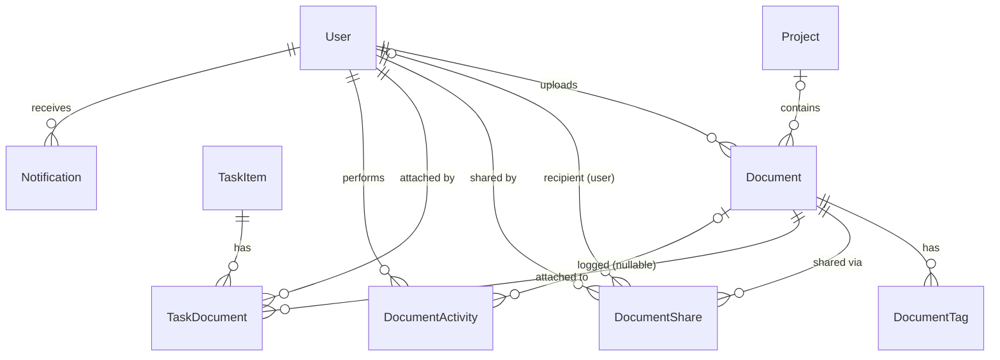
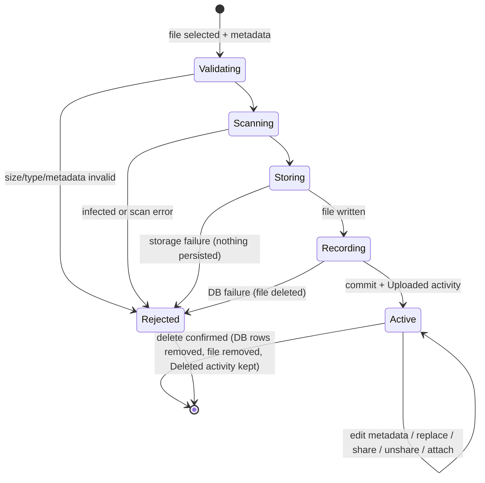

# Data Model: Document Upload and Management

**Feature**: [spec.md](spec.md) · **Plan**: [plan.md](plan.md) · **Decisions**: [research.md](research.md)

All new entities live in the existing `ApplicationDbContext` (SQLite). Keys are `int` identities, timestamps are stored in UTC, and string lengths are enforced with `[MaxLength]`/`[Required]` plus service validation.

## Document

| Field | Type | Rules |
|---|---|---|
| `DocumentId` | int, PK identity | Integer key (stakeholder constraint) |
| `Title` | string(200) | Required; trimmed; non-empty |
| `Description` | string(2000)? | Optional |
| `Category` | string(50) | Required; one of `DocumentCategories.All` (stored as text) |
| `OriginalFileName` | string(255) | Required; file name only (no path), used for display and the download name |
| `StoragePath` | string(500) | Required; **unique**; relative key `{userId}/{projectId\|personal}/{guid}{ext}`, generated server-side before insert |
| `FileType` | string(255) | Required; server-derived MIME type from the extension map |
| `FileSizeBytes` | long | 1 … 26,214,400 |
| `UploadedByUserId` | int, FK → User | Required; owner; `OnDelete: Restrict` |
| `ProjectId` | int?, FK → Project | Optional; uploader must be a member or the PM when setting it; `OnDelete: Restrict` |
| `UploadedDate` | DateTime (UTC) | Set on create |
| `UpdatedDate` | DateTime (UTC) | Set on create, metadata edit, and replace |

Navigations: `UploadedByUser`, `Project`, `Tags`, `Shares`, `TaskLinks`.
Indexes: `UploadedByUserId`, `ProjectId`, `UploadedDate`, `Category`, `StoragePath` (unique).

`DocumentCategories` (static): `Project Documents`, `Team Resources`, `Personal Files`, `Reports`, `Presentations`, `Other`.

**Allowed types** (extension → MIME, signature in [research §4](research.md#4-file-type-validation)):

| Extension | MIME | Preview |
|---|---|---|
| `.pdf` | `application/pdf` | Yes |
| `.jpg`, `.jpeg` | `image/jpeg` | Yes |
| `.png` | `image/png` | Yes |
| `.doc` | `application/msword` | No |
| `.docx` | `application/vnd.openxmlformats-officedocument.wordprocessingml.document` | No |
| `.xls` | `application/vnd.ms-excel` | No |
| `.xlsx` | `application/vnd.openxmlformats-officedocument.spreadsheetml.sheet` | No |
| `.ppt` | `application/vnd.ms-powerpoint` | No |
| `.pptx` | `application/vnd.openxmlformats-officedocument.presentationml.presentation` | No |
| `.txt` | `text/plain` | No |

## DocumentTag

| Field | Type | Rules |
|---|---|---|
| `DocumentTagId` | int, PK | |
| `DocumentId` | int, FK → Document | `OnDelete: Cascade` |
| `Tag` | string(50) | Trimmed, lowercased, non-empty |

Unique index `(DocumentId, Tag)`; index `Tag` (search). Max 10 tags per document.

## DocumentShare

| Field | Type | Rules |
|---|---|---|
| `DocumentShareId` | int, PK | |
| `DocumentId` | int, FK → Document | `OnDelete: Cascade` |
| `SharedWithUserId` | int?, FK → User | Set for a user share; `OnDelete: Restrict` |
| `SharedWithDepartment` | string(100)? | Set for a team share (team = department) |
| `SharedByUserId` | int, FK → User | The document owner at share time; `OnDelete: Restrict` |
| `SharedDate` | DateTime (UTC) | |

Rules: exactly one of `SharedWithUserId` / `SharedWithDepartment` is set (check constraint and service validation). A user cannot share with themselves. Duplicates are rejected by unique indexes `(DocumentId, SharedWithUserId)` and `(DocumentId, SharedWithDepartment)` (SQLite treats NULLs as distinct). Indexes `SharedWithUserId` and `SharedWithDepartment`.

## TaskDocument

| Field | Type | Rules |
|---|---|---|
| `TaskDocumentId` | int, PK | |
| `TaskId` | int, FK → TaskItem | `OnDelete: Cascade` |
| `DocumentId` | int, FK → Document | `OnDelete: Cascade` |
| `AttachedByUserId` | int, FK → User | `OnDelete: Restrict` |
| `AttachedDate` | DateTime (UTC) | |

Unique `(TaskId, DocumentId)`. When attaching to a task with `ProjectId`:
- If the document has no project, set `Document.ProjectId = task.ProjectId` (FR-029).
- If the document belongs to a **different** project, reject the attachment with a message.
- Attaching requires that the user can access the task (existing `TaskService` rule) **and** can read the document. If attaching changes the project, the user must also be allowed to edit the document.

## DocumentActivity

| Field | Type | Rules |
|---|---|---|
| `DocumentActivityId` | int, PK | |
| `DocumentId` | int?, FK → Document | `OnDelete: SetNull` (audit survives deletion) |
| `DocumentTitle` | string(200) | Snapshot at action time |
| `FileType` | string(255) | Snapshot at action time |
| `UserId` | int, FK → User | Actor; `OnDelete: Restrict` |
| `Action` | string(30) | One of `DocumentActions`: `Uploaded`, `Downloaded`, `Previewed`, `MetadataUpdated`, `Replaced`, `Shared`, `Unshared`, `Deleted` |
| `Details` | string(500)? | For example, the share target or replaced file name. Never contains file content or storage paths |
| `OccurredDate` | DateTime (UTC) | |

Indexes `(OccurredDate)`, `(Action, OccurredDate)`, `(UserId)`, `(DocumentId)`. Append-only: no update or delete API.

## Existing entities changed

- `NotificationType`: append `DocumentShared`, `DocumentAdded` (appended to preserve the stored integer values).
- `ApplicationDbContext`: add `DbSet<Document> Documents`, `DbSet<DocumentTag> DocumentTags`, `DbSet<DocumentShare> DocumentShares`, `DbSet<TaskDocument> TaskDocuments`, and `DbSet<DocumentActivity> DocumentActivities`, with the relationships and indexes above. No seed documents (seed files would need on-disk content).
- `DashboardSummary`: add `TotalDocuments` (count of documents uploaded by the user), plus a separate `GetRecentDocumentsAsync(userId, 5)`.

## Authorization matrix

Evaluated by `DocumentService` on every call using the **current DB values** of the actor and the document. Definitions:

- **Owner**: `UploadedByUserId == actor`.
- **ProjectAccess**: the document has a `ProjectId`, and the actor is a `ProjectMember` of it or its `ProjectManagerId`.
- **PM**: the actor is the `ProjectManagerId` of the document's project.
- **TeamLead**: the actor's role is `TeamLead` **and** the uploader's `Department` equals the actor's (non-empty) `Department`.
- **Shared**: a `DocumentShare` exists with `SharedWithUserId == actor`, or with `SharedWithDepartment` equal to the actor's department.
- **Admin**: the actor's role is `Administrator`.

| Action | Owner | ProjectAccess | PM | TeamLead (same dept) | Shared | Admin |
|---|---|---|---|---|---|---|
| View metadata, download, preview | ✓ | ✓ | ✓ | ✓ | ✓ | ✓ |
| Edit metadata (title, description, category, tags) | ✓ | — | — | ✓ | — | — |
| Change project association | ✓ (to a project they access) | — | — | — | — | — |
| Replace file | ✓ | — | — | — | — | — |
| Delete | ✓ | — | ✓ | ✓ | — | ✓ |
| Share / unshare | ✓ | — | — | — | — | — |
| Attach to task (also requires task access) | ✓ | ✓ | ✓ | ✓ | ✓ | ✓ |
| View reports | — | — | — | — | — | ✓ (role only) |

Spec FR mapping: FR-020/021/022/023/024/025/027/032 and edge cases (project removal keeps Owner/Shared access only).

Unauthorized and nonexistent documents are indistinguishable: services return `null` or `NotFound`, endpoints return 404, and the UI shows "Document not available".

## Validation rules (consolidated)

| Rule | Source | Error shown |
|---|---|---|
| 1 ≤ size ≤ 25 MB | FR-003 | "{file} is larger than the 25 MB limit." / "{file} is empty." |
| Extension in the allowlist **and** signature matches | FR-002 | "{file} is not a supported type. Supported: PDF, Word, Excel, PowerPoint, text, JPEG, PNG." |
| Malware scan `Clean` | FR-010 | "{file} was rejected for security reasons." / "Security scan unavailable; try again later." |
| Title 1–200, Category in the list, Description ≤ 2000, ≤ 10 tags ≤ 50 chars | FR-004/005/006 | Field-level messages |
| Project chosen ⇒ actor has ProjectAccess | FR-007 | "You can only add documents to projects you belong to." |
| Search term 2–100 chars | FR-017 | "Enter at least 2 characters." |

## State transitions

`Active` is the only persisted state. No status column exists: a document row exists only for a clean, fully stored file.
