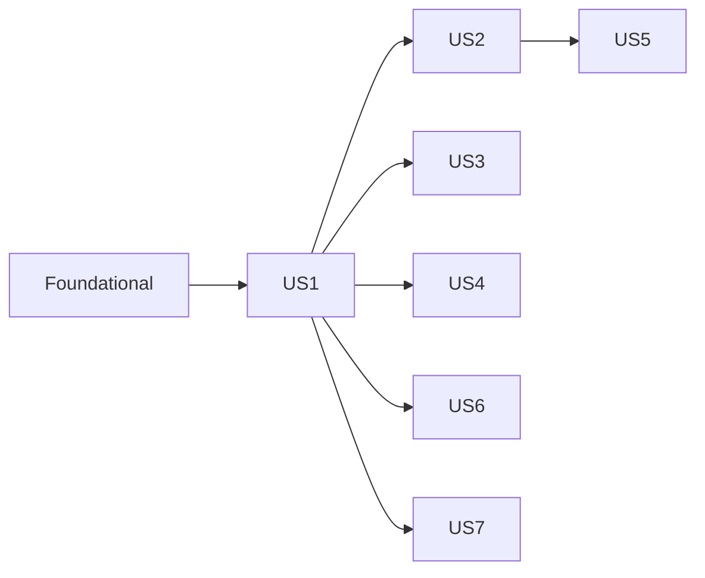

---

description: "Task list for Document Upload and Management"
---

# Tasks: Document Upload and Management

**Input**: Design documents from `/specs/001-document-upload-management/`
**Prerequisites**: [plan.md](plan.md), [spec.md](spec.md), [research.md](research.md), [data-model.md](data-model.md), [contracts/](contracts/), [quickstart.md](quickstart.md)

**Tests**: Included. Constitution Principle V requires focused automated coverage for new behavior, including failure paths for authorization, persistence, and file handling (plan → Complexity Tracking). In each story, write the test tasks first and confirm they fail before implementing.

**Organization**: Tasks are grouped by user story so each story can be implemented and tested independently.

## Format: `[ID] [P?] [Story] Description`

- **[P]**: Can run in parallel (different files, no dependency on incomplete tasks)
- **[Story]**: User story from spec.md (US1–US7)
- Paths are relative to the repository root. App code is in `ContosoDashboard/`; tests are in `ContosoDashboard.Tests/`.

## Shared conventions (apply to every task)

- **Acting user**: Every `IDocumentService` method takes the acting `userId`, loads the actor's current `Role` and `Department` from the DB, and evaluates `DocumentAccessPolicy`. Pages pass only the `ClaimTypes.NameIdentifier` value, read the same way as `Pages/Tasks.razor`.
- **Unauthorized looks like missing**: services return `null`, an empty list, or `DocumentOperationResult(false, null, "Document not available.")`; endpoints return 404.
- **Audit**: Successful upload, metadata update, replace, share, unshare, and delete write one `DocumentActivity` in the same DB transaction, with snapshot `DocumentTitle` and `FileType`. Downloads and previews are recorded by the endpoints.
- **Notifications**: Sent with `INotificationService.CreateNotificationAsync` **after** commit, inside try/catch with `ILogger` logging. A notification failure never fails the operation.
- **Privacy**: Never show or log `StoragePath` or file content; use UTC for storage and local time for display.

---

## Phase 1: Setup (Shared Infrastructure)

**Purpose**: Test project, ignore rules, and configuration needed before any feature code.

- [ ] T001 Create xUnit test project `ContosoDashboard.Tests/ContosoDashboard.Tests.csproj` targeting `net8.0` with `<IsPackable>false</IsPackable>`. Add packages `Microsoft.NET.Test.Sdk`, `xunit` 2.x, `xunit.runner.visualstudio`, `Microsoft.AspNetCore.Mvc.Testing` 8.0.x, and `Microsoft.EntityFrameworkCore.Sqlite` 8.0.0, plus a `ProjectReference` to `ContosoDashboard/ContosoDashboard.csproj`. Verify `dotnet test ContosoDashboard.Tests/ContosoDashboard.Tests.csproj` runs (0 tests).
- [ ] T002 [P] Append `public partial class Program;` at the end of `ContosoDashboard/Program.cs` so `WebApplicationFactory<Program>` can reference it.
- [ ] T003 [P] Add `ContosoDashboard/AppData/` to `.gitignore` under the existing "Local SQLite database" block.
- [ ] T004 [P] Add configuration sections to `ContosoDashboard/appsettings.json`: `"DocumentStorage": { "RootPath": "AppData/uploads" }` and `"MalwareScanning": { "Host": "127.0.0.1", "Port": 3310, "TimeoutSeconds": 30 }`.

---

## Phase 2: Foundational (Blocking Prerequisites)

**Purpose**: Entities, schema, storage, scanning, validation, authorization, auditing, and DI that every story uses.

**⚠️ CRITICAL**: No user story work can begin until this phase is complete.

### Entities and schema

- [ ] T005 [P] Create `Document` and static `DocumentCategories` (`All` = `Project Documents`, `Team Resources`, `Personal Files`, `Reports`, `Presentations`, `Other`) in `ContosoDashboard/Models/Document.cs`. Fields per data-model.md:
  - `DocumentId` int PK identity: "Integer key (stakeholder constraint)".
  - `Title` `[Required][MaxLength(200)]`: "Required; trimmed; non-empty".
  - `Description` `[MaxLength(2000)]` nullable.
  - `Category` `[Required][MaxLength(50)]`: "one of `DocumentCategories.All` (stored as text)".
  - `OriginalFileName` `[Required][MaxLength(255)]`: "file name only (no path)".
  - `StoragePath` `[Required][MaxLength(500)]`: "**unique**; relative key `{userId}/{projectId|personal}/{guid}{ext}`, generated server-side before insert".
  - `FileType` `[Required][MaxLength(255)]`: "server-derived MIME type from the extension map".
  - `FileSizeBytes` long: "1 … 26,214,400".
  - `UploadedByUserId` int FK required.
  - `ProjectId` int? FK.
  - `UploadedDate`, `UpdatedDate` (UTC).
  - Navigations: `UploadedByUser`, `Project`, `Tags`, `Shares`, `TaskLinks`.
- [ ] T006 [P] Create `DocumentTag` in `ContosoDashboard/Models/DocumentTag.cs`: `DocumentTagId` PK, `DocumentId` FK, `Tag` `[Required][MaxLength(50)]` ("Trimmed, lowercased, non-empty"), and navigation `Document`.
- [ ] T007 [P] Create `DocumentShare` in `ContosoDashboard/Models/DocumentShare.cs` with:
  - `DocumentShareId` PK, `DocumentId` FK.
  - `SharedWithUserId` int? FK ("Set for a user share").
  - `SharedWithDepartment` `[MaxLength(100)]` nullable ("Set for a team share (team = department)").
  - `SharedByUserId` int FK.
  - `SharedDate` (UTC).
  - Navigations `Document`, `SharedWithUser`, `SharedByUser`.
- [ ] T008 [P] Create `TaskDocument` in `ContosoDashboard/Models/TaskDocument.cs`: `TaskDocumentId` PK, `TaskId` FK, `DocumentId` FK, `AttachedByUserId` FK, `AttachedDate` (UTC), and navigations `Task`, `Document`, `AttachedByUser`.
- [ ] T009 [P] Create `DocumentActivity` and static `DocumentActions` (`Uploaded`, `Downloaded`, `Previewed`, `MetadataUpdated`, `Replaced`, `Shared`, `Unshared`, `Deleted`) in `ContosoDashboard/Models/DocumentActivity.cs`. Fields:
  - `DocumentActivityId` PK.
  - `DocumentId` int? ("audit survives deletion").
  - `DocumentTitle` `[MaxLength(200)]` snapshot; `FileType` `[MaxLength(255)]` snapshot.
  - `UserId` int FK.
  - `Action` `[MaxLength(30)]`.
  - `Details` `[MaxLength(500)]` nullable ("Never contains file content or storage paths").
  - `OccurredDate` (UTC).
- [ ] T010 [P] Append `DocumentShared` and `DocumentAdded` to the **end** of `NotificationType` in `ContosoDashboard/Models/Notification.cs`. Do not reorder existing values, so stored integers are preserved.
- [ ] T011 Update `ContosoDashboard/Data/ApplicationDbContext.cs` (depends on T005–T009):
  - **DbSets**: `Documents`, `DocumentTags`, `DocumentShares`, `TaskDocuments`, `DocumentActivities`.
  - **Delete behavior**: `Document.UploadedByUser` and `Document.Project` `Restrict`. `DocumentTag`, `DocumentShare`, and `TaskDocument` → `Document` `Cascade`. `TaskDocument` → `TaskItem` `Cascade`. `DocumentShare` user FKs and `TaskDocument.AttachedByUser` `Restrict`. `DocumentActivity.DocumentId` `SetNull`. `DocumentActivity.UserId` `Restrict`.
  - **Indexes**: unique `Document.StoragePath`; `Document` (`UploadedByUserId`), (`ProjectId`), (`UploadedDate`), (`Category`); unique `DocumentTag(DocumentId, Tag)` and `DocumentTag(Tag)`; unique `DocumentShare(DocumentId, SharedWithUserId)` and `(DocumentId, SharedWithDepartment)`; `DocumentShare(SharedWithUserId)`, `(SharedWithDepartment)`; unique `TaskDocument(TaskId, DocumentId)`; `DocumentActivity` (`OccurredDate`), (`Action`, `OccurredDate`), (`UserId`), (`DocumentId`).
  - **Check constraint** on `DocumentShares`: exactly one of `SharedWithUserId` / `SharedWithDepartment` is non-null.
  - No document seed data.

### Abstractions and contracts

- [ ] T012 [P] Create `IFileStorageService` (signatures exactly as in contracts/service-interfaces.md: `UploadAsync(Stream, string storageKey, string contentType, CancellationToken)`, `DeleteAsync`, `DownloadAsync`, `GetUrlAsync`) in `ContosoDashboard/Services/Storage/IFileStorageService.cs`, and `FileStorageOptions { RootPath = "AppData/uploads" }` in `ContosoDashboard/Services/Storage/FileStorageOptions.cs`.
- [ ] T013 [P] Create `ScanOutcome { Clean, Infected, Error }`, `ScanResult(ScanOutcome Outcome, string? Detail)`, and `IMalwareScanner.ScanAsync(Stream, CancellationToken)` in `ContosoDashboard/Services/Scanning/IMalwareScanner.cs`. Create `MalwareScanningOptions { Host = "127.0.0.1", Port = 3310, TimeoutSeconds = 30 }` in `ContosoDashboard/Services/Scanning/MalwareScanningOptions.cs`.
- [ ] T014 [P] Create the shell of `IDocumentService` in `ContosoDashboard/Services/DocumentService.cs`:
  - Declare the interface and all records/enums exactly as in contracts/service-interfaces.md: `UploadRequest`, `DocumentOperationResult`, `DocumentListItem`, `DocumentDetail`, `DocumentShareInfo`, `DocumentQuery`, `DocumentSort`.
  - Add a `DocumentService` class whose constructor takes `ApplicationDbContext`, `IFileStorageService`, `IMalwareScanner`, `DocumentValidator`, `DocumentAccessPolicy`, `IDocumentActivityService`, `INotificationService`, and `ILogger<DocumentService>`.
  - Every method throws `NotImplementedException` until its story task implements it.
- [ ] T015 [P] Create `IDocumentActivityService`, the `DocumentReport` record (per contract), and `DocumentActivityService` in `ContosoDashboard/Services/DocumentActivityService.cs`. Implement `RecordAsync` (adds a `DocumentActivity` with `OccurredDate = DateTime.UtcNow` to the current context without calling `SaveChanges`, so callers commit it in their transaction). `GetReportAsync` throws `NotImplementedException` until T070.

### Test infrastructure

- [ ] T016 [P] Create shared test helpers in `ContosoDashboard.Tests/TestInfrastructure/`:
  - `SqliteTestDatabase.cs`: opens a `DataSource=:memory:` connection, builds an `ApplicationDbContext`, calls `EnsureCreated()` (seeded users 1–4 and project 1), and provides helpers to add users, departments, projects, members, and tasks.
  - `FakeMalwareScanner.cs`: a settable `ScanResult` with a call counter.
  - `TempFileStorage.cs`: a `LocalFileStorageService` over a unique temp directory, deleted on dispose.
  - `TestAuthHandler.cs`: an authentication scheme that reads the user ID from an `X-Test-User` header and returns no result when the header is absent.
  - `DocumentAppFactory.cs`: a `WebApplicationFactory<Program>` that replaces the DB with in-memory SQLite, the storage root with a temp dir, and `IMalwareScanner` with the fake, and registers the test auth scheme.

### Tests for foundational components (write first; must fail)

- [ ] T017 [P] Write `ContosoDashboard.Tests/Services/DocumentValidatorTests.cs` covering:
  - Accepts each allowlisted extension with a matching signature: `%PDF-`; `FF D8 FF`; `89 50 4E 47 0D 0A 1A 0A`; `50 4B 03 04` for docx/xlsx/pptx; `D0 CF 11 E0 A1 B1 1A E1` for doc/xls/ppt; `.txt` with valid UTF-8 and no NUL bytes in the first 8 KB.
  - Rejects: an unknown extension, a signature mismatch (text renamed `.pdf`), a 0-byte file, and 26,214,401 bytes. Accepts exactly 26,214,400 bytes.
  - Maps the extension to the server MIME type and ignores the browser type.
  - Error messages match the data-model.md validation table.
- [ ] T018 [P] Write `ContosoDashboard.Tests/Storage/LocalFileStorageServiceTests.cs` covering:
  - Upload then download round-trip.
  - Directories are created per key.
  - `DeleteAsync` on a missing key is a no-op.
  - `DownloadAsync` on a missing key throws `FileNotFoundException`.
  - Keys with `..` or absolute paths throw `InvalidOperationException`.
  - `GetUrlAsync` throws `NotSupportedException`.
- [ ] T019 [P] Write `ContosoDashboard.Tests/Services/ClamAvMalwareScannerTests.cs` against an in-test `TcpListener` fake clamd: replies `stream: OK` → `Clean`; `stream: Eicar-Signature FOUND` → `Infected` with the signature; no listener (connection refused) → `Error`; a listener that never replies → `Error` after the configured timeout. The scanner never throws.
- [ ] T020 [P] Write `ContosoDashboard.Tests/Services/DocumentAccessPolicyTests.cs` covering every cell of the data-model.md authorization matrix (Owner, ProjectAccess, PM, TeamLead same department vs. different department, Shared by user, Shared by department, Admin, unrelated user) for: read, edit metadata, change project, replace, delete, share. Include the case of a user removed from a project, who keeps access only as Owner or Shared.

### Foundational implementation

- [ ] T021 [P] Implement `DocumentValidator` in `ContosoDashboard/Services/DocumentValidator.cs`:
  - Extension allowlist `.pdf .doc .docx .xls .xlsx .ppt .pptx .txt .jpg .jpeg .png` with the content signatures from research.md §4.
  - Size `1 … 26,214,400` bytes.
  - The extension → MIME map from data-model.md, plus an `IsPreviewable(mime)` helper for `application/pdf`, `image/jpeg`, `image/png`.
  - Metadata validation: Title 1–200 after trim; Category in `DocumentCategories.All`; Description ≤ 2000; tags trimmed, lowercased, de-duplicated, max 10, each ≤ 50.
  - Return the user-facing messages from the data-model.md validation table. Make T017 pass.
- [ ] T022 [P] Implement `LocalFileStorageService` in `ContosoDashboard/Services/Storage/LocalFileStorageService.cs`:
  - Resolve `RootPath` against `IHostEnvironment.ContentRootPath`, and require each `Path.GetFullPath(Path.Combine(root, key))` to start with the root.
  - Write to a temp file in the target directory, then `File.Move`.
  - Make T018 pass.
- [ ] T023 [P] Implement `ClamAvMalwareScanner` in `ContosoDashboard/Services/Scanning/ClamAvMalwareScanner.cs` using `TcpClient`: send `zINSTREAM\0`, then 64 KB chunks each prefixed by a 4-byte big-endian length, then a zero-length terminator. Parse `OK` / `FOUND`. Map timeouts, socket errors, and unexpected replies to `Error`. Never throw. Make T019 pass.
- [ ] T024 Implement `DocumentAccessPolicy` in `ContosoDashboard/Services/DocumentAccessPolicy.cs`:
  - A `DocumentPermissions` record (`CanRead`, `CanEdit`, `CanChangeProject`, `CanReplace`, `CanDelete`, `CanShare`) and `Task<DocumentPermissions?> EvaluateAsync(int actorUserId, int documentId)`, which returns null when the document is missing.
  - An `IQueryable<Document> ReadableBy(IQueryable<Document>, User actor)` filter for lists and search, which translates to SQL and does not load rows client-side.
  - Load the actor's role and department from the DB on every call. Make T020 pass.
- [ ] T025 Register services in `ContosoDashboard/Program.cs` (depends on T014, T015, T021–T024):
  - Bind `FileStorageOptions` to `DocumentStorage` and `MalwareScanningOptions` to `MalwareScanning`.
  - Register `IFileStorageService` → `LocalFileStorageService` and `IMalwareScanner` → `ClamAvMalwareScanner` as singletons.
  - Register `DocumentValidator`, `DocumentAccessPolicy`, `IDocumentActivityService`, and `IDocumentService` as scoped.
- [ ] T026 [P] Add a `Department` claim (`new Claim("Department", user.Department ?? string.Empty)`) to the claims issued in `ContosoDashboard/Pages/Login.cshtml.cs`, alongside NameIdentifier, Name, Email, and Role.

**Checkpoint**: `dotnet build` and `dotnet test` pass (T017–T020 green). Story work can begin.

---

## Phase 3: User Story 1 - Upload and view my documents (Priority: P1) 🎯 MVP

**Goal**: Employees upload one or more validated, scanned files with metadata and see them in a sortable, filterable My Documents list.

**Independent Test**: Log in as Ni Kang, upload a valid PDF with Title "Test Document" and Category "Personal Files", and confirm it appears in My Documents with correct metadata. Upload oversized, unsupported, mismatched, EICAR, and untitled files, and confirm each is rejected with the specified message (quickstart scenarios 1–7).

### Tests for User Story 1 (write first; must fail)

- [ ] T027 [P] [US1] Write `ContosoDashboard.Tests/Services/DocumentUploadTests.cs` covering:
  - A valid upload creates one `Document` with `StoragePath` matching `^4/personal/[0-9a-f]{32}\.pdf$`, stores the file, normalizes the tags, and writes one `Uploaded` activity.
  - Project upload by a member stores under `4/1/`. Project upload by a non-member is rejected with "You can only add documents to projects you belong to.".
  - Oversize, empty, unsupported, and signature-mismatch files are rejected, with nothing stored.
  - Scanner `Infected` and `Error` results are rejected, and no file or row exists.
  - A DB failure after the file write (simulated with a `SaveChangesInterceptor` that throws) leaves no row, and the stored file is deleted.
  - Invalid metadata (missing title or invalid category) is rejected before scanning.
- [ ] T028 [P] [US1] Write `ContosoDashboard.Tests/Services/MyDocumentsQueryTests.cs` covering:
  - Returns only the actor's uploads.
  - Each of the 8 `DocumentSort` values orders correctly.
  - Filters by category, project, and the `FromDate`/`ToDate` range (inclusive day bounds) work alone and combined.
  - `DocumentListItem.CanPreview` is true only for PDF, JPEG, and PNG.

### Implementation for User Story 1

- [ ] T029 [US1] Implement `UploadAsync` in `ContosoDashboard/Services/DocumentService.cs` in this order (research.md §7):
  1. Validate metadata and the file with `DocumentValidator`.
  2. If `ProjectId` is set, require ProjectAccess.
  3. Scan with `IMalwareScanner` (non-`Clean` → reject with the matching message).
  4. Generate the key `{userId}/{projectId|personal}/{Guid.NewGuid():N}{ext}`.
  5. `IFileStorageService.UploadAsync`.
  6. DB transaction: insert `Document` + `DocumentTag`s + `Uploaded` activity, then commit.
  7. On a DB exception, delete the stored file and return a failure.

  Rewind or buffer the stream between scanning and storing. Make T027 pass.
- [ ] T030 [US1] Implement `GetMyDocumentsAsync` in `ContosoDashboard/Services/DocumentService.cs` with `AsNoTracking`, server-side filter and sort per `DocumentQuery`, and projection to `DocumentListItem` (uploader name, project name, tags, `CanPreview`). Make T028 pass.
- [ ] T031 [P] [US1] Create `ContosoDashboard/Shared/Documents/DocumentTable.razor` per contracts/ui-routes.md:
  - Parameters `Items`, `Sortable`, `OnSort`.
  - Columns: Title (plain text for now), Category, Uploaded (local time), Size (human-readable KB/MB), Project.
  - Sortable headers raise `OnSort` with the next `DocumentSort`.
  - Empty state "No documents yet."
- [ ] T032 [P] [US1] Create `ContosoDashboard/Shared/Documents/DocumentUploadDialog.razor` (Bootstrap modal) with parameters `int? FixedProjectId`, `int? TaskId`, `EventCallback OnUploaded`. Fields and controls:
  - `InputFile multiple` with `accept=".pdf,.doc,.docx,.xls,.xlsx,.ppt,.pptx,.txt,.jpg,.jpeg,.png"`.
  - Shared Category select (6 values), Description, and comma-separated Tags.
  - Per-file Title, defaulting to the file name without its extension and editable.
  - Project dropdown from `IProjectService.GetUserProjectsAsync`, hidden when `FixedProjectId` is set.
  - The Upload button is disabled until each file has a title and a category is chosen.

  Upload behavior:
  - Process files **sequentially**. Capture `Name`, `Size`, and `ContentType` into locals **before** `OpenReadStream(26_214_400)`.
  - Copy to a `MemoryStream` in 80 KB chunks, updating a per-file progress bar with `StateHasChanged` after each chunk. Set `Position = 0`, clear the `IBrowserFile` reference, and call `IDocumentService.UploadAsync`.
  - Show a ✓/✗ message per file. Files larger than 25 MB are rejected client-side with the same message before streaming.
  - Re-key `InputFile` with a new `@key` after the batch, then invoke `OnUploaded`.
- [ ] T033 [US1] Create `ContosoDashboard/Pages/Documents.razor` (`@page "/documents"`, `@attribute [Authorize]`):
  - Filter bar: Category select, Project select (user's projects), From/To dates, Apply/Clear.
  - `DocumentTable` with sorting.
  - **Upload** button that opens `DocumentUploadDialog` and reloads the list on `OnUploaded`.
  - Loading and error states.
- [ ] T034 [US1] Add a "My Documents" `NavLink` (`href="documents"`, `bi bi-file-earmark-text`) after "My Projects" in `ContosoDashboard/Shared/NavMenu.razor`.

**Checkpoint**: The MVP is complete. Run T027–T028 and quickstart scenarios 1–7; US1 is demoable on its own.

---

## Phase 4: User Story 2 - Download, preview, and manage my documents (Priority: P2)

**Goal**: Users with access download and preview documents; uploaders (and roles per the matrix) edit, replace, and delete them.

**Independent Test**: Using a US1 document, download it (original name), preview a PDF in a new tab, confirm a `.docx` offers download only, edit its metadata, replace its file, then delete it with Cancel and Confirm. Another user gets 404 or "Document not available" (quickstart scenarios 8, 9, 11, 17).

### Tests for User Story 2 (write first; must fail)

- [ ] T035 [P] [US2] Write `ContosoDashboard.Tests/Endpoints/DocumentEndpointsTests.cs` with `DocumentAppFactory`:
  - **Download as owner**: 200, the stored `Content-Type`, `Content-Disposition: attachment` with the original name (including `Q4 Report (2025) - Finance & Ops.pdf`), `Cache-Control: no-store`, `X-Content-Type-Options: nosniff`, and one `Downloaded` activity.
  - **Preview a PDF/PNG**: 200, `inline`, the sandbox CSP, and a `Previewed` activity. Preview of `.docx` → 404.
  - **Other user, nonexistent ID, or file missing on disk**: 404 with no activity.
  - **No `X-Test-User`**: not 200.
- [ ] T036 [P] [US2] Write `ContosoDashboard.Tests/Services/DocumentManagementTests.cs` covering:
  - `GetDocumentAsync` returns null for unauthorized and missing documents and sets the `Can*` flags per the matrix.
  - `UpdateMetadataAsync`: allowed for the owner and a same-department TeamLead; denied for others with "Document not available."; validates fields; writes `MetadataUpdated`; changing the project requires access to the target project.
  - `ReplaceFileAsync`: allowed for the owner only. It stores a new key and deletes the old file, and updates `FileType`/`FileSizeBytes`/`OriginalFileName`/`UpdatedDate` and writes `Replaced`. A failing scan or DB write keeps the old file and row unchanged and removes the new file.
  - `DeleteAsync`: allowed for the owner, PM, same-department TeamLead, and Admin; denied for a member, a sharee, and an unrelated user. It removes the row, tags, shares, task links, and file. The `Deleted` activity remains with `DocumentId` null.

### Implementation for User Story 2

- [ ] T037 [US2] Implement `GetDocumentAsync` (detail and `Can*` flags from `DocumentAccessPolicy`; `Shares` only when `CanShare`) and `OpenForReadAsync` (requires `CanRead`, and for `preview` requires `DocumentValidator.IsPreviewable`; returns null when the file is missing) in `ContosoDashboard/Services/DocumentService.cs`.
- [ ] T038 [US2] Implement `UpdateMetadataAsync` in `ContosoDashboard/Services/DocumentService.cs`: `CanEdit` is required, and `CanChangeProject` plus ProjectAccess to the new project are required when `projectId` changes. Apply the T021 metadata validation, replace the tags, set `UpdatedDate`, and record `MetadataUpdated` in the same transaction.
- [ ] T039 [US2] Implement `ReplaceFileAsync` in `ContosoDashboard/Services/DocumentService.cs`: `CanReplace` → validate → scan → upload to a **new** key → DB update + `Replaced` activity (Details = new original name) → commit → best-effort delete of the old key (log on failure). On DB failure, delete the new file.
- [ ] T040 [US2] Implement `DeleteAsync` in `ContosoDashboard/Services/DocumentService.cs`: `CanDelete` → transaction (record `Deleted` with snapshots, then remove the `Document`, which cascades to tags, shares, and task links) → commit → best-effort file delete (log on failure). Make T036 pass.
- [ ] T041 [P] [US2] Create `ContosoDashboard/Endpoints/DocumentEndpoints.cs` with `MapDocumentEndpoints(this IEndpointRouteBuilder)` per contracts/http-endpoints.md:
  - `GET /api/documents/{documentId:int}/download` → `Results.File(stream, fileType, originalFileName, enableRangeProcessing: true)`.
  - `GET /api/documents/{documentId:int}/preview` → inline `Content-Disposition` + `Content-Security-Policy: sandbox; default-src 'none'; img-src 'self'; object-src 'self'`.
  - Both use `RequireAuthorization()`, add `Cache-Control: no-store` and `X-Content-Type-Options: nosniff`, return `Results.NotFound()` when the service returns null, and record `Downloaded`/`Previewed` via `IDocumentActivityService` + `SaveChangesAsync` on success.
- [ ] T042 [US2] Call `app.MapDocumentEndpoints();` after `app.UseAuthorization()` and before `app.MapBlazorHub()` in `ContosoDashboard/Program.cs`. Make T035 pass.
- [ ] T043 [P] [US2] Extend `ContosoDashboard/Shared/Documents/DocumentTable.razor`: the Title links to `/documents/{DocumentId}`; add an Actions column with **Download** (`/api/documents/{id}/download`) and, when `CanPreview`, **Preview** (`/api/documents/{id}/preview`, `target="_blank" rel="noopener"`).
- [ ] T044 [US2] Create `ContosoDashboard/Pages/DocumentDetails.razor` (`@page "/documents/{DocumentId:int}"`, `@attribute [Authorize]`):
  - Shows "Document not available" when `GetDocumentAsync` returns null.
  - Metadata display with Download and Preview (new tab) links.
  - Edit form (title, description, category, tags, project) when `CanEdit`.
  - Replace (`InputFile` single, same MemoryStream pattern as T032) when `CanReplace`.
  - Delete when `CanDelete`, with a confirmation modal "Permanently delete '{title}'? This cannot be undone." (Cancel leaves it unchanged; Confirm deletes and navigates to `/documents`).
  - Results shown in Bootstrap alerts.

**Checkpoint**: US1 + US2 work independently; quickstart scenarios 8, 9, 11, and 17 pass.

---

## Phase 5: User Story 3 - Project documents (Priority: P3)

**Goal**: Project members and the PM see, download, and upload project documents; others on the project are notified of additions.

**Independent Test**: As Ni Kang, upload a document to project 1 from Project Details. As Camille (PM), see it in Project Documents, download it, delete it, and confirm she received a "DocumentAdded" notification. Ni receives no notification for her own upload (quickstart scenarios 2, 10).

### Tests for User Story 3 (write first; must fail)

- [ ] T045 [P] [US3] Write `ContosoDashboard.Tests/Services/ProjectDocumentsTests.cs` covering:
  - `GetProjectDocumentsAsync` returns all project documents for members, the PM, and Admin, and an empty list for non-members.
  - A project upload creates one `DocumentAdded` notification per member and PM, excluding the uploader, with the document title and project name in the message.
  - A notification failure (throwing fake `INotificationService`) still returns success and keeps the document.

### Implementation for User Story 3

- [ ] T046 [US3] Implement `GetProjectDocumentsAsync` in `ContosoDashboard/Services/DocumentService.cs`: ProjectAccess or Admin is required (otherwise return empty); `AsNoTracking`, ordered by `UploadedDate desc`, projected to `DocumentListItem`.
- [ ] T047 [US3] Extend `UploadAsync` in `ContosoDashboard/Services/DocumentService.cs`: after commit, when `ProjectId` is set, notify the distinct project members and the PM except the uploader (`NotificationType.DocumentAdded`, `NotificationPriority.Informational`, title "New project document", message "{uploader} added '{title}' to {project}."), wrapped in try/catch with logging. Make T045 pass.
- [ ] T048 [US3] Add a "Project Documents" card to `ContosoDashboard/Pages/ProjectDetails.razor` below Project Tasks: `DocumentTable` fed by `GetProjectDocumentsAsync`, and an **Upload to project** button that opens `DocumentUploadDialog` with `FixedProjectId="ProjectId"` and reloads on `OnUploaded`.

**Checkpoint**: Quickstart scenarios 2 and 10 pass; US3 works with US1 alone.

---

## Phase 6: User Story 4 - Search documents (Priority: P4)

**Goal**: Users find accessible documents by title, description, tags, uploader name, or project name, with results within 2 seconds.

**Independent Test**: Seed documents for several users and projects; search for terms in each field. Results include only accessible matches, and an unmatched or inaccessible term shows "No documents found" (quickstart scenario 12).

### Tests for User Story 4 (write first; must fail)

- [ ] T049 [P] [US4] Write `ContosoDashboard.Tests/Services/DocumentSearchTests.cs` covering:
  - Each searchable field matches case-insensitively: title, description, tag, uploader display name, project name.
  - Inaccessible matches are excluded (another user's personal document; a project the actor is not in).
  - Admin sees all matches.
  - `%`, `_`, and `\` are matched literally.
  - Terms shorter than 2 characters or longer than 100 (after trim) return empty.
  - Results are capped at 100 and ordered by `UploadedDate desc`.

### Implementation for User Story 4

- [ ] T050 [US4] Implement `SearchAsync` in `ContosoDashboard/Services/DocumentService.cs`: trim and validate the length 2–100; escape `\`, `%`, `_`; build the pattern `%term%` with `EF.Functions.Like(..., pattern, "\\")` across title, description, `Tags.Any(t.Tag)`, `UploadedByUser.DisplayName`, and `Project.Name`; apply `DocumentAccessPolicy.ReadableBy`; `AsNoTracking`; `Take(100)`; project to `DocumentListItem`. Make T049 pass.
- [ ] T051 [P] [US4] Create `ContosoDashboard/Pages/DocumentSearch.razor` (`@page "/documents/search"`, `@attribute [Authorize]`): a search input with a Search button and Enter key; inline validation "Enter at least 2 characters."; results in `DocumentTable`; empty state "No documents found".
- [ ] T052 [US4] Add a "Search Documents" `NavLink` (`href="documents/search"`, `bi bi-search`) after "My Documents" in `ContosoDashboard/Shared/NavMenu.razor`.

**Checkpoint**: Quickstart scenario 12 passes.

---

## Phase 7: User Story 5 - Share documents (Priority: P5)

**Goal**: Owners share documents with users or departments; recipients are notified, get read-only access, and see the documents in Shared with Me; owners can revoke shares.

**Independent Test**: As Ni, share a personal PDF with Camille and another document with "Engineering". Recipients are notified, see the documents in Shared with Me, and can download but not edit, delete, or share. Removing Camille's share makes her download return 404 (quickstart scenarios 13, 14).

**Depends on**: US2 (adds the share panel to `DocumentDetails.razor`).

### Tests for User Story 5 (write first; must fail)

- [ ] T053 [P] [US5] Write `ContosoDashboard.Tests/Services/DocumentSharingTests.cs` covering:
  - Only the owner can share or unshare; others get "Document not available.".
  - Sharing with yourself is rejected; a duplicate user or department share is rejected; department values are trimmed and must match an existing user `Department`.
  - Notifications: a user share sends 1 `DocumentShared` notification. A department share notifies each current department member except the sharer, exactly once, even when a member already has a direct share.
  - Activities: `Shared` and `Unshared` are recorded with details.
  - Sharee access: can read and download, cannot edit, replace, delete, or share.
  - `GetSharedWithMeAsync` returns each document once for direct + department shares and excludes the user's own uploads.
  - Removing a share revokes access unless another route (ProjectAccess, department share) still grants it.
  - Deleting a document removes it from Shared with Me.

### Implementation for User Story 5

- [ ] T054 [US5] Implement `ShareWithUserAsync` and `ShareWithDepartmentAsync` in `ContosoDashboard/Services/DocumentService.cs`: `CanShare` → validate the target → insert a `DocumentShare` (`SharedByUserId` = actor, `SharedDate` UTC) + a `Shared` activity (Details = "user:{name}" / "department:{dept}") → commit → notify the recipients (`NotificationType.DocumentShared`, title "Document shared with you", message "{owner} shared '{title}' with you.").
- [ ] T055 [US5] Implement `RemoveShareAsync` (only the owner of the share's document; records `Unshared`) and `GetSharedWithMeAsync` (direct shares or the actor's department, excluding the actor's uploads, distinct, ordered by the latest `SharedDate`) in `ContosoDashboard/Services/DocumentService.cs`. Make T053 pass.
- [ ] T056 [US5] Add a Sharing panel to `ContosoDashboard/Pages/DocumentDetails.razor`, visible when `CanShare`:
  - The current shares list (`DocumentDetail.Shares`) with Remove buttons.
  - "Share with user": a select from `IUserService.GetAllUsersAsync`, excluding the actor.
  - "Share with team": a select of distinct non-empty `Department` values from the same list.
  - Success and error alerts.
- [ ] T057 [P] [US5] Create `ContosoDashboard/Pages/SharedDocuments.razor` (`@page "/documents/shared"`, `@attribute [Authorize]`) listing `GetSharedWithMeAsync` in `DocumentTable`, with the empty state "Nothing has been shared with you yet."
- [ ] T058 [US5] Add a "Shared with Me" `NavLink` (`href="documents/shared"`, `bi bi-share`) after "My Documents" in `ContosoDashboard/Shared/NavMenu.razor`.

**Checkpoint**: Quickstart scenarios 13 and 14 pass.

---

## Phase 8: User Story 6 - Task and dashboard integration (Priority: P6)

**Goal**: Task details show, upload, and attach documents (inheriting the task's project); the dashboard shows a document count card and the 5 most recent documents.

**Independent Test**: As Ni, open a project task, upload a document, and attach an existing personal document. Both appear on the task and show project 1. The dashboard shows the count and Recent Documents (quickstart scenarios 15, 16).

### Tests for User Story 6 (write first; must fail)

- [ ] T059 [P] [US6] Write `ContosoDashboard.Tests/Services/TaskDocumentsTests.cs` covering:
  - `GetTaskDocumentsAsync` returns only attached documents the actor can read, and returns empty when the actor cannot access the task (existing `TaskService` rule).
  - `AttachToTaskAsync` requires task access + `CanRead`. A document without a project inherits the task's `ProjectId` (requires `CanEdit`). A document in a different project is rejected. A duplicate attach is rejected. A task without a project leaves the document unassociated.
  - `UploadAsync` with `TaskId` attaches the document and inherits the task's project.
  - `DetachFromTaskAsync` is allowed for the attacher, the document owner, or the task creator only.
- [ ] T060 [P] [US6] Write `ContosoDashboard.Tests/Services/DashboardDocumentsTests.cs` covering:
  - `DashboardSummary.TotalDocuments` counts only the user's uploads.
  - `GetRecentDocumentsAsync(userId, 5)` returns the 5 newest of the user's uploads, newest first.
  - `CountMyDocumentsAsync` matches `TotalDocuments`.

### Implementation for User Story 6

- [ ] T061 [US6] Implement `GetTaskDocumentsAsync`, `AttachToTaskAsync`, and `DetachFromTaskAsync` in `ContosoDashboard/Services/DocumentService.cs`:
  - Check task access with the same rules as `TaskService.GetTaskByIdAsync` (assigned user, creator, project member, PM).
  - Insert `TaskDocument` with `AttachedByUserId`/`AttachedDate` UTC.
  - Apply the project inheritance and rejection rules from data-model.md → TaskDocument: "If the document has no project, set `Document.ProjectId = task.ProjectId`", and "If the document belongs to a **different** project, reject the attachment with a message".
- [ ] T062 [US6] Extend `UploadAsync` in `ContosoDashboard/Services/DocumentService.cs`: when `UploadRequest.TaskId` is set, require task access, use the task's `ProjectId` as the document project, and insert the `TaskDocument` in the same transaction. Make T059 pass.
- [ ] T063 [US6] Implement `GetRecentDocumentsAsync` and `CountMyDocumentsAsync` in `ContosoDashboard/Services/DocumentService.cs` (actor's uploads only, `AsNoTracking`).
- [ ] T064 [P] [US6] Add `public int TotalDocuments { get; set; }` to `DashboardSummary` and populate it (`Documents.CountAsync(d => d.UploadedByUserId == userId)`) in `GetDashboardSummaryAsync` in `ContosoDashboard/Services/DashboardService.cs`. Make T060 pass.
- [ ] T065 [P] [US6] Create `ContosoDashboard/Shared/Documents/DocumentAttachDialog.razor` with parameters `int TaskId` and `EventCallback OnAttached`: search the actor's accessible documents via `SearchAsync` (and "My recent" via `GetMyDocumentsAsync`), select one, call `AttachToTaskAsync`, and show the result message.
- [ ] T066 [US6] Create `ContosoDashboard/Pages/TaskDetails.razor` (`@page "/tasks/{TaskId:int}"`, `@attribute [Authorize]`):
  - Load the task via `ITaskService.GetTaskByIdAsync`; show "Task not available" when null.
  - Show title, description, status, priority, due date, and a project link.
  - A "Documents" card: `DocumentTable` from `GetTaskDocumentsAsync`, a Detach action, an **Upload** button (`DocumentUploadDialog` with `TaskId`), and an **Attach existing** button (`DocumentAttachDialog`).
- [ ] T067 [P] [US6] Implement `ViewTaskDetails(int taskId)` in `ContosoDashboard/Pages/Tasks.razor` to `NavigationManager.NavigateTo($"/tasks/{taskId}")` (inject `NavigationManager`), replacing the TODO.
- [ ] T068 [US6] Update `ContosoDashboard/Pages/Index.razor`:
  - Add a fifth summary card "My Documents" showing `summary.TotalDocuments`, linking to `/documents`, styled like the existing cards.
  - Add a "Recent Documents" widget listing `GetRecentDocumentsAsync(currentUserId, 5)` (title link to `/documents/{id}`, category, upload date), with the empty state "No documents uploaded yet."

**Checkpoint**: Quickstart scenarios 15 and 16 pass.

---

## Phase 9: User Story 7 - Activity audit and reports (Priority: P7)

**Goal**: All document actions are audited, and Administrators view usage reports for a date range.

**Independent Test**: Upload, download, share, and delete documents. As Admin, open Document Reports for today and see the matching types, uploaders, and access data, including the deleted document. As Ni, `/documents/reports` is denied (quickstart scenarios 18, 19).

### Tests for User Story 7 (write first; must fail)

- [ ] T069 [P] [US7] Write `ContosoDashboard.Tests/Services/DocumentReportTests.cs` covering:
  - `GetReportAsync` returns null for non-Administrators.
  - For an Administrator over a UTC range: `TopUploadedTypes` groups `Uploaded` by `FileType` (descending count); `TopUploaders` gives the top 10 by `Uploaded` count with names; `AccessByDay` counts `Downloaded`/`Previewed` per UTC day; `MostAccessedDocuments` gives the top 10 by access count, using the snapshot title when the document is deleted.
  - Activities outside the range are excluded.
  - Each of the 8 `DocumentActions` is produced by its operation (end-to-end through `DocumentService` and the endpoints).

### Implementation for User Story 7

- [ ] T070 [US7] Implement `GetReportAsync` in `ContosoDashboard/Services/DocumentActivityService.cs`: load the actor's role from the DB (`Administrator` only, otherwise null); run four `AsNoTracking` aggregate queries over `[fromUtc, toUtc)` per research.md §11. Make T069 pass.
- [ ] T071 [P] [US7] Create `ContosoDashboard/Pages/DocumentReports.razor` (`@page "/documents/reports"`, `@attribute [Authorize(Policy = "Administrator")]`): From/To date inputs (default: last 30 days, converted to the UTC range); four Bootstrap tables (Most uploaded types, Most active uploaders, Access by day, Most accessed documents); empty states.
- [ ] T072 [US7] Add a "Document Reports" `NavLink` (`href="documents/reports"`, `bi bi-bar-chart`) inside `<AuthorizeView Roles="Administrator">` in `ContosoDashboard/Shared/NavMenu.razor`.

**Checkpoint**: All stories are complete; quickstart scenarios 18 and 19 pass.

---

## Phase 10: Polish & Cross-Cutting Concerns

**Purpose**: Performance verification, documentation, security review, and final validation.

- [ ] T073 [P] Write `ContosoDashboard.Tests/Performance/DocumentPerformanceTests.cs` (`[Trait("Category", "Performance")]`): seed 500 documents with tags, shares, and 2 projects, then assert `GetMyDocumentsAsync`, `GetProjectDocumentsAsync`, and `SearchAsync` each complete in under 2 seconds (SC-003, SC-004).
- [ ] T074 [P] Update `README.md`:
  - Add Document Management to Implemented Features.
  - Add ClamAV to Prerequisites (link to [quickstart.md](quickstart.md#prerequisites)).
  - Document `AppData/uploads` storage, the clean-reset steps (DB + uploads), and the new `ContosoDashboard.Tests` test command.
- [ ] T075 Security review of `ContosoDashboard/Endpoints/DocumentEndpoints.cs`, `ContosoDashboard/Services/DocumentService.cs`, `ContosoDashboard/Services/Storage/LocalFileStorageService.cs`, and the new pages:
  - No page, DTO, log, or activity `Details` exposes `StoragePath`.
  - Every `IDocumentService` method checks permissions before any data or file access.
  - All `OriginalFileName` values are only rendered through Razor encoding.
  - Endpoint headers match contracts/http-endpoints.md.

  Fix any findings.
- [ ] T076 Run `dotnet build ContosoDashboard/ContosoDashboard.csproj` and `dotnet test ContosoDashboard.Tests/ContosoDashboard.Tests.csproj`; resolve all errors and any new warnings in feature files.
- [ ] T077 Execute [quickstart.md](quickstart.md) steps 1–6 (all 19 scenarios, including a 25 MB upload under 30 s and a PDF preview under 3 s) with ClamAV running, and record pass/fail per scenario in the pull request description.

---

## Dependencies & Execution Order

### Phase Dependencies

- **Setup (Phase 1)**: no dependencies.
- **Foundational (Phase 2)**: depends on Setup and **blocks all stories**.
- **User Stories (Phases 3–9)**: depend on Foundational. US1 provides the upload UI and content that every later story uses for manual testing, so complete it first (MVP).
- **Polish (Phase 10)**: after the desired stories.

### User Story Dependencies



- **US1 (P1)**: Foundational only.
- **US2 (P2)**: US1 (adds links to `DocumentTable`).
- **US3 (P3)**: US1 (reuses `DocumentUploadDialog` with `FixedProjectId`, extends `UploadAsync`).
- **US4 (P4)**: US1 (`DocumentTable`). Independent of US2 and US3.
- **US5 (P5)**: US2 (share panel in `DocumentDetails.razor`).
- **US6 (P6)**: US1 (`DocumentUploadDialog` with `TaskId`, `DocumentTable`). Independent of US2–US5.
- **US7 (P7)**: US1 for meaningful data. Reports aggregate activities produced by every story.

### Within Each User Story

- Tests first (they fail), then service methods, then components and pages, then navigation.
- Tasks editing `ContosoDashboard/Services/DocumentService.cs` run sequentially (shared file).
- Tasks editing `ContosoDashboard/Shared/NavMenu.razor` (T034, T052, T058, T072) and `ContosoDashboard/Program.cs` (T002, T025, T042) run sequentially.

### Parallel Opportunities

- **Setup**: T002, T003, T004.
- **Foundational**:
  - models T005–T010
  - contracts T012–T015
  - test infrastructure T016
  - tests T017–T020
  - implementations T021–T023, plus T026
- **Each story**: its test tasks run together, and `[P]` UI components run alongside service work (different files).
- **Across stories**: after US1, US3/US4/US6/US7 can proceed in parallel, but their `DocumentService.cs` edits must be serialized or merged carefully.

---

## Parallel Example: User Story 1

```bash
# Tests first, together:
Task: "T027 DocumentUploadTests in ContosoDashboard.Tests/Services/DocumentUploadTests.cs"
Task: "T028 MyDocumentsQueryTests in ContosoDashboard.Tests/Services/MyDocumentsQueryTests.cs"

# While T029–T030 (DocumentService.cs) are in progress, build UI components in parallel:
Task: "T031 DocumentTable in ContosoDashboard/Shared/Documents/DocumentTable.razor"
Task: "T032 DocumentUploadDialog in ContosoDashboard/Shared/Documents/DocumentUploadDialog.razor"
```

## Parallel Example: Foundational

```bash
Task: "T005 Document model"   Task: "T006 DocumentTag"   Task: "T007 DocumentShare"
Task: "T008 TaskDocument"     Task: "T009 DocumentActivity"   Task: "T010 NotificationType values"
Task: "T017 Validator tests"  Task: "T018 Storage tests"  Task: "T019 Scanner tests"  Task: "T020 Access policy tests"
```

---

## Implementation Strategy

### MVP First (User Story 1 Only)

**Phases**: Setup → Foundational → US1
**Tasks**: T001–T034 (34 tasks)
**Deliverable**: Users upload validated, malware-scanned documents and view, sort, and filter them in My Documents.

1. Complete Phase 1 (T001–T004) and Phase 2 (T005–T026); confirm the checkpoint (build + foundational tests green).
2. Complete Phase 3 (T027–T034).
3. **STOP and VALIDATE**: run the tests and quickstart scenarios 1–7 (requires ClamAV running).
4. Demo the MVP.

### Incremental Delivery

1. MVP (US1) → demo.
2. US2 (manage/download/preview) → validate scenarios 8, 9, 11, 17.
3. US3 (project documents) → scenarios 2, 10.
4. US4 (search) → scenario 12.
5. US5 (sharing) → scenarios 13, 14.
6. US6 (tasks + dashboard) → scenarios 15, 16.
7. US7 (audit reports) → scenarios 18, 19.
8. Polish (T073–T077).

### Parallel Team Strategy

After Foundational + US1: Developer A takes US2 → US5, Developer B takes US3 + US4, and Developer C takes US6 + US7. Coordinate `DocumentService.cs` and `NavMenu.razor` edits through small, frequent merges.

---

## Notes

- Before starting `/speckit.implement`, mark [spec.md](spec.md) as approved (Constitution Principle I).
- Reset the training database and uploads before the first run ([quickstart.md §1](quickstart.md#1-reset-the-training-database)); `EnsureCreated` does not add the new tables to an existing DB.
- Run the app with `DOTNET_ROLL_FORWARD=Major` if only a newer .NET runtime is installed.
- Commit after each task or checkpoint; stop at any checkpoint to validate a story on its own.
